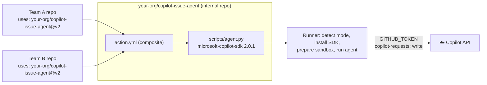
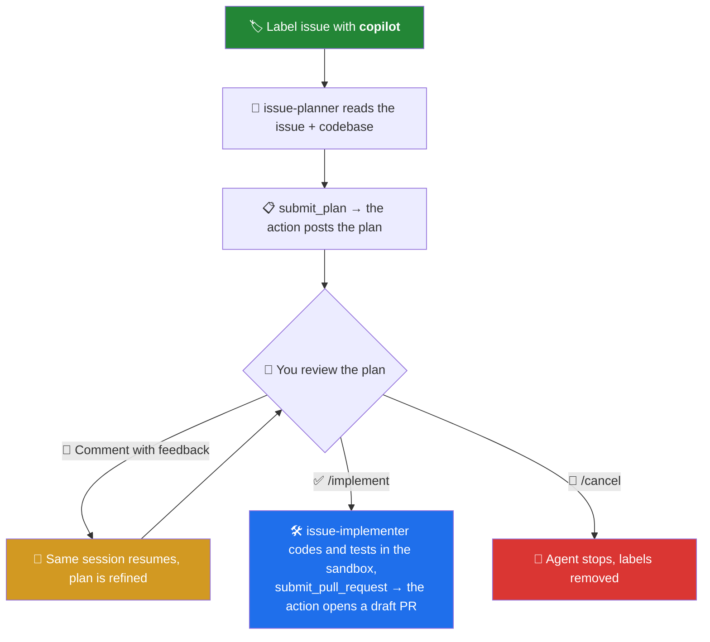
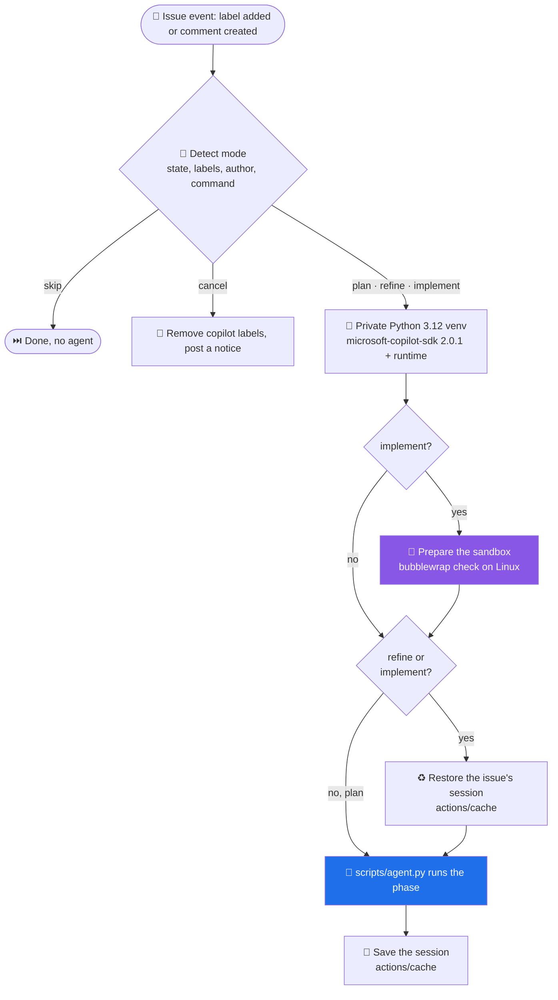
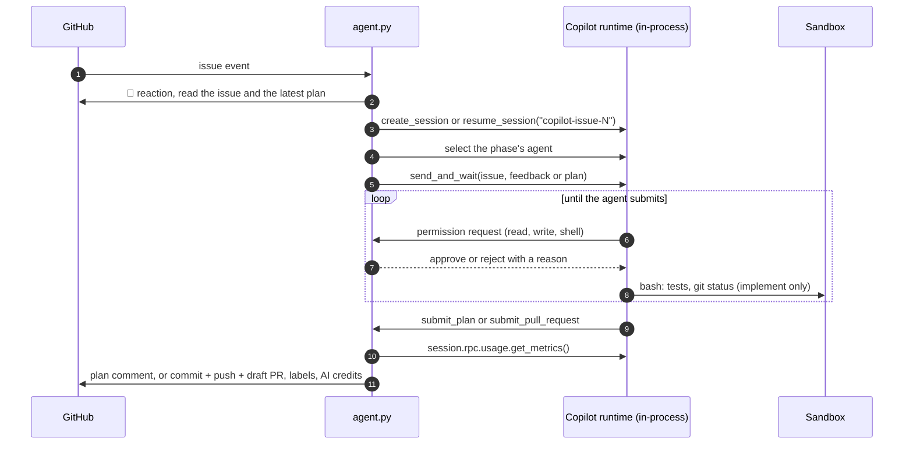
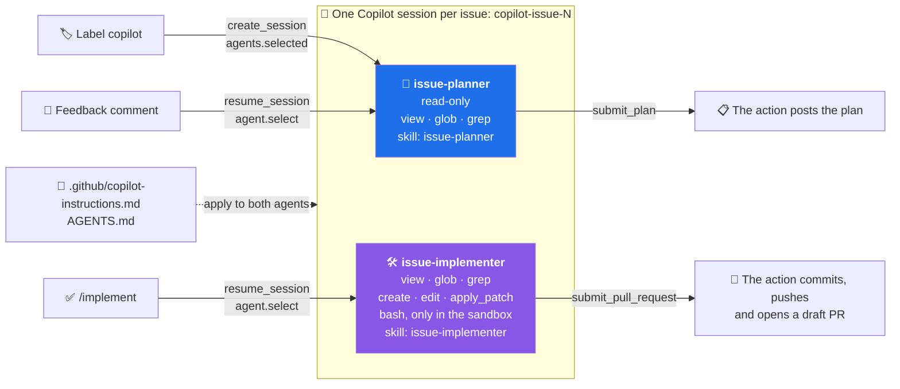
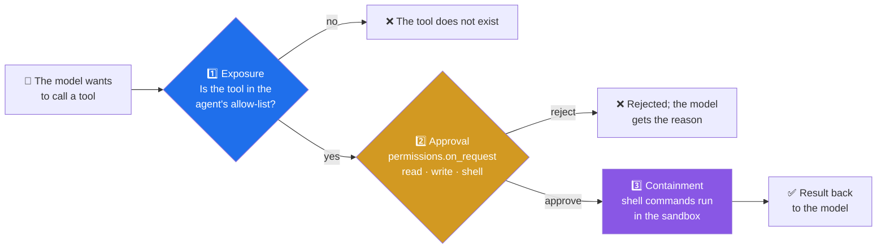
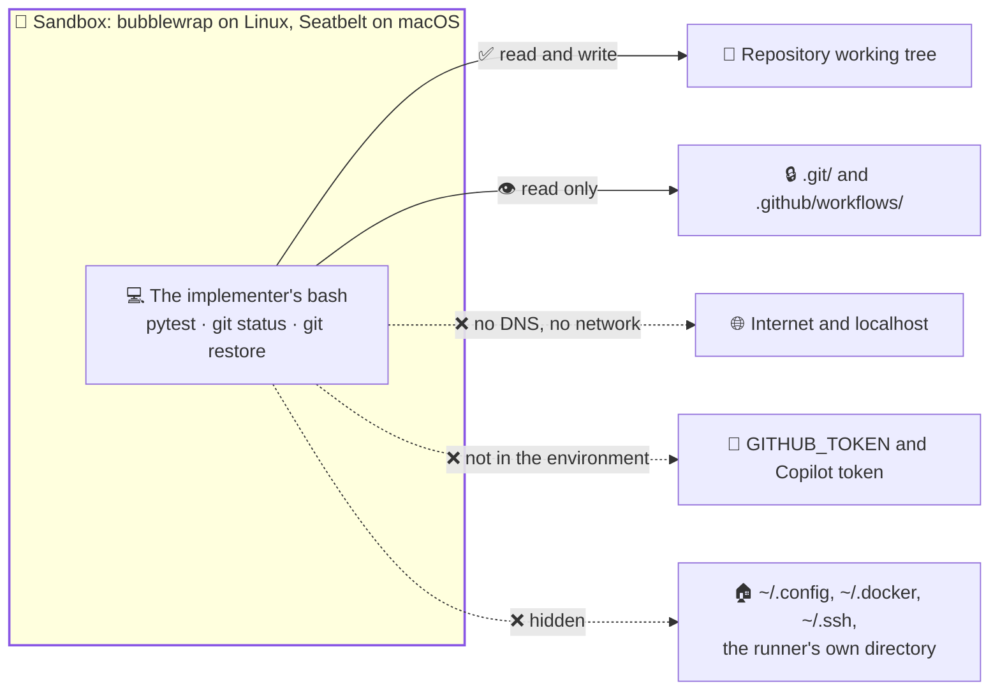
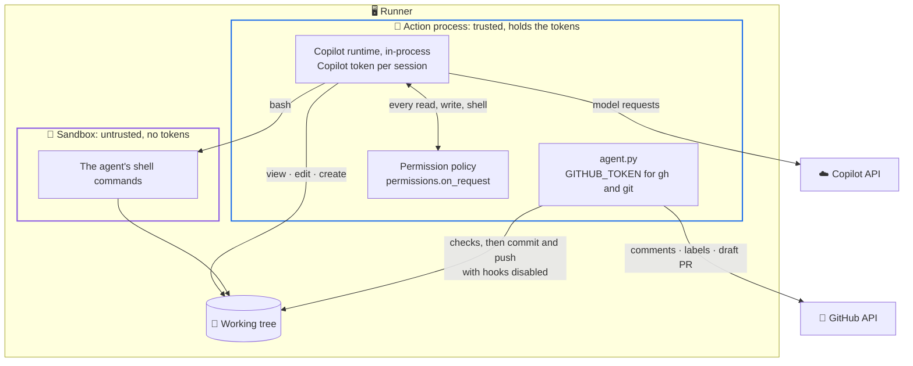
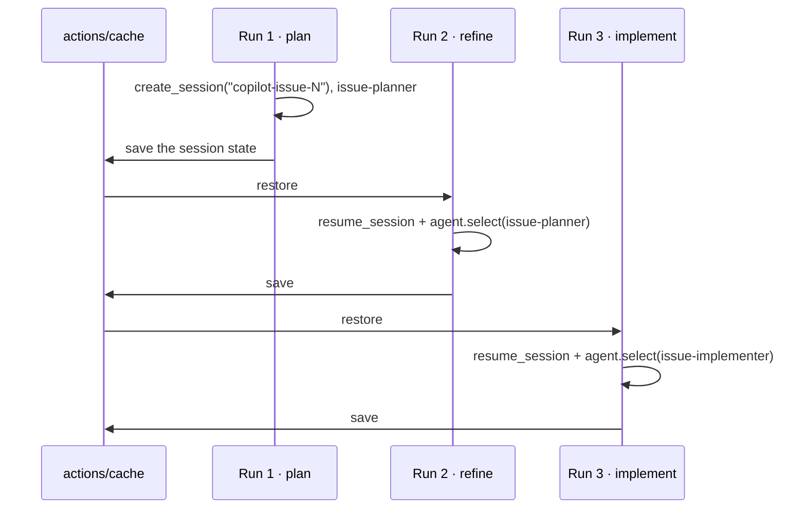
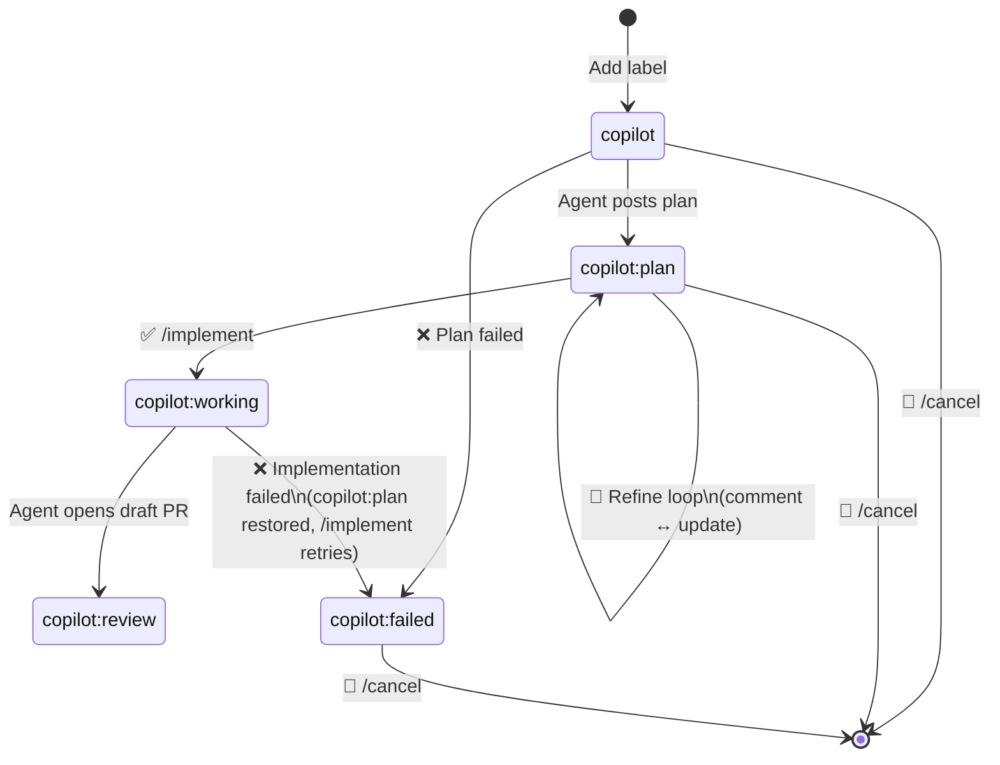

# 🤖 Copilot Issue Agent

> 📱 **Scan to open this repo** — share with session participants:
>
> 
>
> <https://github.com/jeffrey-groneberg/issue-implementer>

**Label-to-PR Autopilot**: a GitHub Composite Action built on the **Microsoft Copilot SDK 2.0** (`microsoft-copilot-sdk` 2.0.1, Python). Add a label to an issue, get an implementation plan, refine it in the comments, and let the agent implement the code and open a draft pull request.

> [!NOTE]
> GitHub recommends [GitHub Agentic Workflows](https://github.github.com/gh-aw/) for most AI automation in Actions. This action is a hands-on showcase of what you can build yourself with the Microsoft Copilot SDK.

## What's New in 2.0

Version 2.0 moves from the GitHub Copilot SDK 0.2 to the **Microsoft Copilot SDK 2.0** and hands everything the SDK now does to the SDK. The action keeps the workflow logic; the SDK provides the agent, its guardrails and its memory.

| Feature | Microsoft Copilot SDK 2.0 API | What it does here |
|---|---|---|
| In-process runtime | `CopilotClient(runtime=RuntimeConnection.for_default(base_directory=...))` | The runtime runs inside the Python process: no Node.js, no npm, no Copilot CLI install |
| Empty client mode | `CopilotClient(mode="empty")` | No ambient tools, files or instructions; every session opts in explicitly |
| Session identity | `CopilotClient(github={"use_logged_in_user": False})`, `create_session(github={"token": ...})` | The workflow `GITHUB_TOKEN` with `copilot-requests: write` makes the Copilot requests (a PAT is optional). The runtime has no identity of its own; the token goes to each session over the SDK connection |
| Custom agents | `agents={"definitions": [...], "selected": ...}`, `session.rpc.agent.select(...)` | `issue-planner` (read-only) and `issue-implementer`, each with its own tools and preloaded skill |
| Skills | `skills={"enabled": True, "directories": [...]}` | The plan format and implementation rules live in [`skills/`](skills) |
| Repository instructions | `instructions={"skip_custom_instructions": False}` | The repository's own `.github/copilot-instructions.md` and `AGENTS.md` apply |
| Tool allow-list | `tools={"available_tools": ToolSet()...}` | Only the selected agent's tools exist, for example `builtin:view` and `custom:submit_plan` |
| Custom tools | `define_tool(..., is_terminal=True, skip_permission=True)` | `submit_plan` and `submit_pull_request` hand results back and end the turn |
| Permission policy | `permissions={"on_request": ...}` with typed requests | Reads stay in the repository; writes stay out of `.git/` and `.github/workflows/`; everything else is rejected |
| Sandbox *(experimental)* | `permissions={"sandbox": SandboxConfig(...)}` | The implementer's shell has no network access and a read-only `.git/` |
| Session events | `events={"on_event": ...}` | Tool calls, the model Copilot picked for `auto`, and messages stream into the job log |
| Durable sessions | `create_session(session_id=...)`, `resume_session(...)` | One conversation per issue: refine and implement resume the planning session |
| Budget *(experimental)* | `execution={"limits": {"max_ai_credits": ...}}` | Soft AI credit cap per session |
| Cost reporting *(experimental)* | `session.rpc.usage.get_metrics()` | AI credits per run and per session in every comment and the job summary |

### What 2.0 Removed

| Version 1 built it by hand | Version 2 uses |
|---|---|
| Node.js setup and `npm install @github/copilot` | The SDK's in-process runtime |
| A fine-grained PAT as a required secret | The workflow `GITHUB_TOKEN` with `copilot-requests: write` |
| `approve_all` plus a pre-tool hook with a shell allowlist, blocked patterns and a write counter | Per-agent tool allow-lists, the typed permission policy and the sandbox |
| A post-tool audit hook | Session events |
| `.github/copilot-agent.yml` | Action inputs and the repository's own Copilot instructions |
| Three phase scripts and a `get_issue` tool | One entry point, [`scripts/agent.py`](scripts/agent.py); the issue goes into the prompt |
| A refinement round limit | The AI credit budget |

## Why This Exists

GitHub.com offers powerful built-in agent capabilities like [Copilot coding agent](https://docs.github.com/en/copilot/using-github-copilot/using-copilot-coding-agent): you can assign an issue to Copilot and it will autonomously analyze the codebase, write code, and open a pull request.

**These features are not available on every GitHub instance.** [GitHub Enterprise Server (GHES)](https://docs.github.com/en/enterprise-server@latest/admin/all-releases) lags behind github.com, and many Copilot-powered features, including the coding agent and assigning issues to Copilot, are unavailable or delayed there.

**This action bridges that gap** and shows how little code it takes. It combines the [Microsoft Copilot SDK](https://github.com/microsoft/copilot-sdk) with a standard GitHub Actions workflow to replicate the core agent experience. All it needs is a token that can make Copilot requests: on GitHub.com that is the workflow `GITHUB_TOKEN` with `copilot-requests: write`; elsewhere pass a token for an account with a Copilot license through `copilot-token`.

> **TL;DR:** If you want Copilot to work on your issues inside your own workflow, with your own guardrails, this action is for you.

## Why a Composite Action?

This project is packaged as a [Composite Action](https://docs.github.com/en/actions/sharing-automations/creating-actions/creating-a-composite-action) rather than a Docker or JavaScript action. This is a deliberate choice for maximum portability, especially on GHES:

- **No build step required.** Composite actions are just YAML + scripts. They run directly on the caller's runner without building a container image or bundling Node.js modules.
- **Works on any runner.** Self-hosted runners don't always have Docker available. Composite actions only need a shell and Python.
- **Easy to share across an enterprise.** Host this action in an [internal repository](https://docs.github.com/en/enterprise-server@latest/repositories/creating-and-managing-repositories/about-repositories#about-internal-repositories) visible to all organization members. Any repo on the same instance can then reference it with `uses: your-org/issue-implementer@v2`; no marketplace publishing needed.
- **Transparent and auditable.** All logic lives in four short Python files and a YAML file. Security teams can review exactly what runs.



### Sharing on GHES

1. **Fork or mirror** this repository into your instance as an **internal** repository (e.g. `your-org/copilot-issue-agent`)
2. **Tag a release** (e.g. `v2`) so consumers can pin to a stable version
3. **Enable Actions access**: Settings → Actions → General → [Access](https://docs.github.com/en/enterprise-server@latest/repositories/managing-your-repositorys-settings-and-features/enabling-features-for-your-repository/managing-github-actions-settings-for-a-repository#allowing-access-to-components-in-an-internal-repository) → *"Accessible from repositories in the organization"*
4. **Consumers** add the workflow to their repo referencing `your-org/copilot-issue-agent@v2`

The SDK downloads its pinned runtime from GitHub releases. Runners without access to github.com can point `COPILOT_CLI_DOWNLOAD_BASE_URL` at a mirror or `COPILOT_CLI_PATH` at a pre-installed runtime.

## How It Works

The agent operates in a **plan → refine → implement** loop driven by labels and issue comments:



### Phase Details

| Phase | Trigger | Agent | What Happens | Label After |
|-------|---------|-------|-------------|-------------|
| **Plan** | Add label `copilot` to an issue | `issue-planner` | Reads the issue from the prompt, explores the code with `view`/`glob`/`grep`, calls `submit_plan` | `copilot:plan` |
| **Refine** | Comment on a `copilot:plan` issue (any text except commands) | `issue-planner` | Resumes the session, applies your feedback, calls `submit_plan` with the updated plan | `copilot:plan` |
| **Implement** | Comment `/implement` on a `copilot:plan` issue | `issue-implementer` | Resumes the session, edits files, runs tests in the sandbox, calls `submit_pull_request` | `copilot:review` |
| **Cancel** | Comment `/cancel` on a copilot-managed issue | – | Removes the copilot labels and posts a cancellation notice | *(labels removed)* |

Only repository owners, organization members and collaborators can drive the agent with comments. Everyone else's comments are ignored, so nobody can spend your AI credits through a drive-by comment.

### One Run, Step by Step

Every issue event starts one workflow run. The composite action ([`action.yml`](action.yml)) decides what to do and prepares only what that mode needs:



### Inside the Agent Run

The agent decides; the action acts. Every GitHub side effect (reactions, labels, comments, branch, commit, pull request) is plain Python in [`scripts/agent.py`](scripts/agent.py), and every SDK call is in [`scripts/copilot_session.py`](scripts/copilot_session.py):



## Custom Agents

The action defines two custom agents with `agents.definitions`. Both live in every session, so a resumed conversation always knows them; each phase selects the one it needs. A new session selects it with `agents.selected`. A resumed session keeps the agent it last used, so the action switches with `session.rpc.agent.select(...)`.



| | `issue-planner` | `issue-implementer` |
|---|---|---|
| Phases | plan, refine | implement |
| Built-in tools | `view`, `glob`, `grep` | `view`, `glob`, `grep`, `create`, `edit`, `apply_patch`, and `bash` when the sandbox is available |
| Custom tool | `submit_plan` | `submit_pull_request` |
| Preloaded skill | [`issue-planner`](skills/issue-planner/SKILL.md): plan format and rules | [`issue-implementer`](skills/issue-implementer/SKILL.md): implementation rules and PR summary |
| Hands back | The complete plan | Title, commit message, summary, test results |
| Then the action | Posts the plan comment | Checks the changes, commits, pushes, opens the draft PR |

How the pieces fit together, simplified from [`copilot_session.py`](scripts/copilot_session.py):

```python
await client.create_session(
    session_id="copilot-issue-42",
    agents={"definitions": [planner, implementer],  # each with its own "tools" and "skills"
            "selected": "issue-planner",
            "included_builtin_agents": []},          # no built-in sub-agents
    skills={"enabled": True, "directories": ["skills"]},
    instructions={"skip_custom_instructions": False}, # the repository's Copilot instructions
    tools={"definitions": [submit_plan],              # define_tool(..., is_terminal=True)
           "available_tools": ToolSet().add_builtin(["view", "glob", "grep"])
                                       .add_custom("submit_plan")},
    ...
)
```

- **Least privilege per agent**: the session's `tools.available_tools` is exactly the selected agent's tool list, so the planner cannot edit files or run commands.
- **No surprise delegation**: `infer: False` keeps the runtime from handing work to an agent on its own, and `included_builtin_agents=[]` disables the built-in sub-agents.
- **Terminal custom tools**: `submit_plan` and `submit_pull_request` are defined with `is_terminal=True` (a successful call ends the turn) and `skip_permission=True` (the action owns them). They only validate and record the result; if a check fails, for example too many changed files, the agent gets the reason and can fix it.
- **Skills and instructions**: each agent preloads its skill from [`skills/`](skills), and both follow the repository's own `.github/copilot-instructions.md` or `AGENTS.md`.

## Sandboxing and Guardrails

Guardrails come in three layers, all provided by the SDK. Each layer blocks on its own; together they assume the model can be wrong or manipulated by issue content. This is the path every tool call takes:



### 1. Exposure: Which Tools Exist

The client runs in `mode="empty"`, so a session has no tools unless it opts in. The session's `tools.available_tools` allow-list contains exactly the selected agent's tools (see [Custom Agents](#custom-agents)): planning is read-only, and no tool can reach GitHub. The two custom tools only validate and record the result; the action does the GitHub work after the session ends.

### 2. Approval: What Each Request May Do

`permissions.on_request` receives typed requests from the runtime and approves or rejects each one ([`denial_reason`](scripts/copilot_session.py)):

- **Read**: only files in the repository and the action's skills
- **Write**: only files in the repository, never `.git/` or `.github/workflows/`, checked for every file of a multi-file edit and after resolving symlinks
- **Shell**: only when the sandbox is on, and never a request to leave it
- **Everything else** (URLs, MCP, memory and so on) and anything that needs a person's approval: rejected

### 3. Containment: The Sandbox

`permissions.sandbox` (experimental) runs the implementer's shell in the runtime's sandbox, built from the action's [`sandbox_config`](scripts/copilot_session.py): the repository is writable, `.git/` and `.github/workflows/` are read-only, there is no outbound or local network access, and `allow_bypass=False`. The planner has no shell, so it needs no sandbox.



Verified by running commands through the agent's sandboxed shell with the action's own configuration (`session.rpc.shell.execute_user_requested`, no model involved):

| Inside the sandbox | `ubuntu-latest` runner (bubblewrap 0.11.1) | macOS (Seatbelt) |
|---|---|---|
| `git status`, writing a file in the repository | ✅ works | ✅ works |
| Writing to `.git/` or `.github/workflows/` | ❌ `Read-only file system` | ❌ `Operation not permitted` |
| `curl https://api.github.com` | ❌ `Could not resolve host` | ❌ `Could not resolve host` |
| Token or secret variables in `env` | none | none |
| Home directory | only `.cache`, `.cargo`, `.dotnet`, `.local` and `work` visible | not readable |

**No sandbox, no shell**: where the sandbox is unavailable, the implementer gets no `bash` tool and cannot run tests.

- **Linux**: bubblewrap 0.5.0 or later. `ubuntu-latest` ships it; elsewhere the action installs it, lifts Ubuntu 24.04's AppArmor restriction on unprivileged user namespaces when necessary, and checks that bubblewrap works.
- **macOS**: the built-in Seatbelt sandbox.
- **Windows or a failed check**: no sandbox, so no shell; the log and the job summary say so.

Because the sandbox has no network, install what your tests need before the action runs (see the [workflow example](#1-create-the-workflow-file)).

### Around the Agent

The agent's commands run in the sandbox; the credentials stay in the action's process, and only deterministic code uses them:



- **No token in the agent's reach**: before the in-process runtime starts, credentials are removed from the process environment, and the action removes any credential `actions/checkout` persisted in `.git/config`. The Copilot token is passed per session rather than to the client, because the SDK hands a client-level token to the in-process runtime as an environment variable that the agent's shell would inherit. The GitHub token only reaches the `gh` and `git` processes that need it.
- **Publishing checks**: the action stages the changes itself and refuses empty changes, workflow files (renames included) and more than `max-files-changed` files. It refuses to publish if the repository's git configuration changed during the run, and runs git with hooks disabled.
- **Untrusted input**: issue text, comments and feedback are fenced as user content in the prompts, and only plans posted by the action itself count, so nobody can forge a plan comment.
- **Loop protection**: every comment the action posts carries a marker, and the action ignores comments with that marker, even when `github-token` is a personal token.
- **Budget and time**: `max-ai-credits` sets a soft cap per session (checked between model calls, so one response can exceed it; the runtime also tells the model its budget). If the budget runs out, the action answers the runtime's request with *cancel*. `timeout-minutes` bounds every run.

## Durable Sessions

Each issue has one Copilot session, `copilot-issue-<number>`. The plan phase creates it with `create_session(session_id=...)`; refine and implement continue it with `resume_session(...)` and switch to their agent with `session.rpc.agent.select(...)`, so the implementer starts with everything the planner learned. Between workflow runs, the session state (`<runner temp>/copilot-agent-home/session-state`) is stored with `actions/cache`, which needs `cache-mode: write` in the workflow.



If the cache is missing (no `cache-mode: write`, or eviction after 7 days without access), the agent starts a fresh session with the issue in the prompt. Nothing breaks: the latest plan is always part of the prompt.

## Quick Start

### 1. Create the Workflow File

Create `.github/workflows/copilot.yml` in your repository:

```yaml
name: Copilot Issue Agent

on:
  issues:
    types: [labeled]
  issue_comment:
    types: [created]

permissions:
  contents: write          # push the agent's branch
  issues: write            # labels, reactions, plan comments
  pull-requests: write     # open the draft pull request
  copilot-requests: write  # let GITHUB_TOKEN call Copilot

cache-mode: write          # keep each issue's Copilot session between runs

concurrency:
  group: copilot-issue-${{ github.event.issue.number }}
  cancel-in-progress: false

jobs:
  copilot:
    runs-on: ubuntu-latest
    timeout-minutes: 30
    steps:
      - uses: actions/checkout@v7
        with:
          persist-credentials: false   # keep the token out of .git/config

      # Optional: install what your tests need. The agent's sandbox has no network.
      - uses: actions/setup-python@v7
        with:
          python-version: '3.12'
      - run: pip install -r requirements-dev.txt

      - uses: jeffrey-groneberg/issue-implementer@v2
        with:
          max-ai-credits: '300'
```

The action detects the mode (plan, refine, implement, cancel or skip) and only runs the agent when relevant. The `concurrency` group keeps runs for the same issue in order, which the durable session relies on. Issue events get read-only cache access by default, so [`cache-mode: write`](https://docs.github.com/actions/reference/workflows-and-actions/workflow-syntax#cache-mode) lets the action save the session; GitHub shows a warning annotation for it. The action only saves the cache in runs that a maintainer started. This repository's own [workflow](.github/workflows/copilot-agent.yml) also skips runner start-up for unrelated comments.

### 2. Allow Actions to Create Pull Requests

Go to your repo → **Settings → Actions → General → Workflow permissions** and check **Allow GitHub Actions to create and approve pull requests**. Or via CLI:

```bash
gh api repos/<owner>/<repo>/actions/permissions/workflow \
  -X PUT -F can_approve_pull_request_reviews=true
```

### 3. Check Copilot Billing

With `copilot-requests: write`, the workflow's `GITHUB_TOKEN` makes the Copilot requests ([docs](https://docs.github.com/en/copilot/how-tos/copilot-cli/use-copilot-cli-in-actions)). Usage is billed in GitHub AI Credits:

- **Organization-owned repositories** bill the organization. The policy *Allow use of Copilot CLI billed to the organization* must be enabled (it is on by default where Copilot CLI is enabled).
- **Personal repositories** bill the repository owner's Copilot plan.

Prefer a personal token? Store a fine-grained PAT with the **Copilot Requests** permission as a secret and pass it as `copilot-token`. It is used for Copilot requests only; issue and pull request operations still use `GITHUB_TOKEN`.

### 4. Bootstrap the Trigger Label

The workflow only fires when an issue is labeled `copilot`, but on a fresh repo that label doesn't exist yet. The action creates the `copilot:*` labels on its first run, so you only need to create `copilot` once:

```bash
gh label create copilot \
  --color 0e8a16 \
  --description "Trigger label for Copilot Issue Agent" \
  --repo <owner>/<repo>
```

> 💡 In the GitHub web UI you can type `copilot` into the label picker and it will offer to create it inline.

### 5. Try It Out

1. Open a new issue describing a feature or bug fix
2. Add the `copilot` label
3. About a minute later the agent posts an implementation plan
4. Comment with feedback to refine it, or comment `/implement`

## Interacting with the Agent

### Starting the Agent

Add the `copilot` label to any open issue. The action reacts with 👀, the `issue-planner` agent analyzes the issue and the repository and submits a plan, and the action posts it and changes the label from `copilot` to `copilot:plan`. The plan comment ends with the SDK version, the model (for `auto`, the model Copilot picked), the session ID and the AI credits the run used.

### Refining the Plan

Comment on the issue with your feedback, for example:

> "Please also add input validation for negative exponents"

> "Use the existing `MathUtils` class instead of creating a new file"

The action reacts with 👀 and **resumes the same Copilot session**, so the planner remembers everything it learned while planning. It posts the complete updated plan. The AI credit budget, not a round counter, bounds how often you can refine.

### Implementing

When the plan looks good, comment:

```
/implement
```

The action reacts with 🚀 and switches the label to `copilot:working`. The session resumes with the `issue-implementer` agent, which edits the files, runs the tests in the sandbox and calls `submit_pull_request`. The action then:

1. Checks the changes: at least one file, no more than `max-files-changed`, no workflow files
2. Commits to `copilot/issue-<number>` with the agent's Conventional Commits message and a `Co-authored-by` trailer for you
3. Pushes the branch, opens a draft PR that closes the issue, comments the link with the AI credits used, and sets `copilot:review`

### Cancelling

At any point, comment:

```
/cancel
```

This removes all copilot labels and stops the agent.

## Configuration

### Action Inputs

| Input | Default | Description |
|---|---|---|
| `github-token` | `${{ github.token }}` | Token for issue and PR operations; also used for Copilot requests unless `copilot-token` is set |
| `copilot-token` | *(empty)* | Optional token for Copilot requests only (fine-grained PAT with **Copilot Requests**) |
| `model` | `auto` | Copilot model ID, for example `claude-sonnet-5.5`, or `auto` to let Copilot pick per request |
| `reasoning-effort` | *(model default)* | `low`, `medium`, `high`, `xhigh` or `max`, for a pinned model |
| `max-files-changed` | `10` | Maximum files one implementation may change |
| `timeout-minutes` | `15` | Timeout for one agent run |
| `max-ai-credits` | *(none)* | Soft AI credit budget per session (`execution.limits.max_ai_credits`, experimental); the runtime's minimum is 30 |

### Action Outputs

| Output | Description |
|---|---|
| `mode` | `plan`, `refine`, `implement`, `cancel` or `skip` |
| `session-id` | The issue's Copilot session ID, `copilot-issue-<number>` |
| `ai-credits` | AI credits this run used (from `session.rpc.usage.get_metrics()`, experimental) |
| `pull-request-url` | The draft pull request opened by the implement phase |

### Repository Instructions

There is no config file. Tell the agent about your project the way you tell any Copilot agent: in `.github/copilot-instructions.md` or `AGENTS.md`. The SDK loads them into both agents, for example:

```markdown
- Python 3.12. Add type hints to every function signature.
- Tests use pytest and live in `tests/`. Run them with `python -m pytest -q`.
```

## Labels Lifecycle



A failed refinement keeps `copilot:plan`, so you can simply comment again.

## Architecture

```
action.yml                    ← Composite action: mode detection, SDK install, sandbox, session cache
scripts/
  agent.py                    ← Entry point: plan, refine and implement; labels, comments, PR, summary
  copilot_session.py          ← Every SDK call: client, agents, tools, permissions, sandbox, events, sessions
  tools.py                    ← Custom tools submit_plan and submit_pull_request
  github_ops.py               ← gh and git, with the token kept away from the agent
skills/
  issue-planner/SKILL.md      ← Plan format and planning rules
  issue-implementer/SKILL.md  ← Implementation and submission rules
tests/                        ← Unit tests: permission policy, tools, publishing rules, settings
```

### Mode Detection

| Event | Condition | Mode |
|-------|-----------|------|
| `issues` / `labeled` | Label is `copilot`, no `copilot:plan`/`copilot:working` yet | **plan** |
| `issue_comment` / `created` | Any text, issue has `copilot:plan` | **refine** |
| `issue_comment` / `created` | `/implement`, issue has `copilot:plan` | **implement** |
| `issue_comment` / `created` | `/cancel`, issue has a copilot label | **cancel** |
| `issue_comment` / `created` | Author is not owner, member or collaborator, is a bot, or the comment came from the agent | **skip** |
| Any | Issue is closed, or the comment is on a pull request | **skip** |

## Requirements

- **Runner**: Linux or macOS; `ubuntu-latest` recommended. The action sets up its own Python 3.12 environment without changing the job's `PATH`, and needs `gh` and `git`. Linux runners need `sudo` to install bubblewrap for the sandbox, or bubblewrap preinstalled.
- **Copilot**: a token that can make Copilot requests: `GITHUB_TOKEN` with `copilot-requests: write`, or a `copilot-token`.
- **Repository permissions**: `contents: write`, `issues: write`, `pull-requests: write`, and *Allow GitHub Actions to create and approve pull requests*.

## Migrating from v1

1. Remove the `COPILOT_PAT` secret from the workflow and add `copilot-requests: write` to its `permissions` (or pass the PAT as `copilot-token`; `copilot-pat` is gone).
2. Remove the Node.js and Copilot CLI setup if you added it yourself; the SDK brings its runtime.
3. Move the settings from `.github/copilot-agent.yml` to action inputs, and `additional_instructions` to `.github/copilot-instructions.md`. `extra_allowed_commands`, `max_refinement_rounds` and the custom trigger names are gone: the sandbox replaces the command allowlist, and `max-ai-credits` bounds the cost.
4. Set `persist-credentials: false` on `actions/checkout`, add `cache-mode: write`, and install your test dependencies before the action, because the sandbox has no network.

## Development

Run the unit tests:

```bash
python -m pip install -r requirements.txt pytest
python -m pytest -q tests
```

Run a phase locally against a test repository: check it out, then set the variables the action would set and run the entry point from this repository:

```bash
export GITHUB_REPOSITORY=<owner>/<test-repo> GITHUB_WORKSPACE=/path/to/test-repo ISSUE_NUMBER=1
export GH_TOKEN="$(gh auth token)" AGENT_ROOT=/path/to/issue-implementer
python -m copilot download-runtime --in-process
python "$AGENT_ROOT/scripts/agent.py" plan
# refine: COMMENT_BODY="your feedback" COMMENT_AUTHOR=<you> python "$AGENT_ROOT/scripts/agent.py" refine
# implement: SANDBOX_STATUS=on COMMENT_AUTHOR=<you> python "$AGENT_ROOT/scripts/agent.py" implement
```

The token needs Copilot access; a local `gh auth token` works for an account with a Copilot license.

## License

MIT
